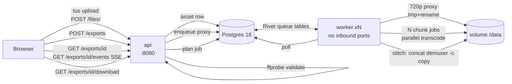

# Chunked Video Export Pipeline

A backend portfolio project: resumable uploads, proxy transcodes, and a
fan-out export pipeline that renders video chunks in parallel and stitches
them deterministically — with progress streaming and crash recovery.

Stack: **Go 1.22+ · PostgreSQL 16 · River** (`github.com/riverqueue/river`, pgx v5 —
the only queue) · **tusd** (`github.com/tus/tusd/v2`) embedded for resumable
uploads · **FFmpeg/ffprobe via `os/exec` only** · Docker Compose
(`postgres`, `api`, `worker` — no other services).

Doc pages consulted instead of guessed (per project rules):
- River client/workers/config/migrations: `pkg.go.dev/github.com/riverqueue/river`
  (pinned `v0.17.0`; rescuer internals verified in
  `internal/maintenance/job_rescuer.go`: `JobRescuerIntervalDefault = 30s`),
  `riverqueue.com/docs`
- tusd embedding + hooks: `tus.github.io/tusd/advanced-topics/usage-package/`,
  `pkg.go.dev/github.com/tus/tusd/v2/pkg/handler` (pinned `v2.8.0`)
- FFmpeg segment/concat muxers: `ffmpeg.org/ffmpeg-formats.html`

## Architecture



One binary, two subcommands: `server api` and `server worker`. Config by env
vars (`.env`; commit only `.env.example`). Packages: `api, jobs, media,
store, config` — no global state.

## State machines (the contract)

Allowed transitions (all enforced as conditional
`UPDATE ... WHERE status = expected`, so a stale worker can never overwrite
newer state — see `internal/store/store.go`):

```
asset:   uploaded -> validated | rejected | failed
         validated -> proxy_ready | failed

export:  planned -> rendering -> stitching -> done
         planned | rendering | stitching -> failed | canceled

chunk:   pending -> running -> done | failed
         running -> pending   (stuck heartbeat rescue, attempts++)
         failed  -> pending   (retry, attempts++)
```

`UNIQUE(export_id, idx)` on chunks. Re-running a done chunk is a no-op
(`CompleteChunk` returns success when already `done`).

## Determinism (kill-run hash == clean-run hash)

Every chunk encode uses fixed settings: `-threads 1`, fixed GOP
(`-g 48 -keyint_min 48 -sc_threshold 0`), `-fflags +bitexact
-flags:v +bitexact`, `-map_metadata -1`, `-vsync cfr`, identical audio
(`aac 128k/48k/stereo`), same pinned ffmpeg (`Dockerfile`:
`debian:bookworm-slim` + `ffmpeg=7:5.1.*`). Temp files keep the `.mp4`
extension (ffmpeg infers format from it) and are atomically renamed.
Stitch is a stream copy (`concat` demuxer, `-c copy`).

## Benchmark (REAL numbers, same 1080p/30s testsrc input)

`scripts/bench.ps1 -AssetId <uuid>` scales `worker` to 1/2/4 containers and
times one export each. Sample input: `scripts/sample.ps1 -Seconds 30`
(ffmpeg `testsrc=1920x1080:30` + `sine=440Hz`, deterministic flags).

| workers (containers) | seconds | export id |
|---|---|---|
| _TBD: run `scripts/bench.ps1` after chaos_ | | |

(Numbers are filled in from real runs — never invented. See `BENCH.md`
after running.)

## How to run

```powershell
Copy-Item .env.example .env   # then set a >=32 char API_KEY
.\scripts\up.ps1              # compose up --build + health check
.\scripts\sample.ps1 -Seconds 30
.\scripts\upload-resume.ps1   # Phase 2 gate: kill halfway, resume, sha256
.\scripts\export-verify.ps1   # Phase 4 gate: frames, duration, hash
```

Chaos (Phase 6 gate — kills worker containers mid-chunk, verifies recovery):

```powershell
.\scripts\chaos.ps1 -Runs 20 -Rounds 3
```

Verifies per run: (a) output frame count == source, (b) kill-run sha256 ==
clean-run sha256, (c) zero duplicate chunk completions, (d) all chunks `done`
with attempts recorded. Prints a summary table; exits non-zero on failure.

```powershell
.\scripts\bench.ps1 -AssetId <uuid>   # 1/2/4 workers timing
curl.exe -N -H "X-API-Key: <key>" http://localhost:8080/exports/<id>/events  # live SSE
```

## Gate results

| Phase | Result |
|---|---|
| 1 skeleton+DB | `docker compose up` clean, `/healthz` 200, migrations idempotent across restarts |
| 2 resumable upload | killed at offset 714684/1429369, server HEAD returned 714684 (not 0), resumed, stored sha256 == local |
| 3 proxy | 1280x720 h264, 30.016s vs 30.000s source (<=0.1s) |
| 4 fan-out export | 900/900 frames, 30.022s vs 30.000s, 3 chunks planned/rendered/stitched |
| 5 SSE | `curl.exe -N` showed live `chunk`/`progress` events; resume via `Last-Event-ID` (DB replay + deltas) |
| 6 chaos | _running: see `chaos.log` / summary below_ |
| 7 bench+docs | this README, `SECURITY.md`, `DEBUGGING.md` |

## Repo layout

```
cmd/server/main.go        api|worker|migrate subcommands, river client, graceful shutdown
internal/api/server.go    handlers, tusd mount, auth, SSE, rate limit, security headers
internal/jobs/jobs.go     proxy / plan / chunk / stitch River workers
internal/media/media.go   ffprobe validate, keyframe planner, deterministic ffmpeg args
internal/store/           pgx store, conditional updates, plain-SQL migrations
migrations/001_init.sql   operator copy of the embedded migration
openapi.yaml              contract-first API
scripts/                  up/sample/upload-resume/export-verify/chaos/bench (.ps1)
Dockerfile                multi-stage, non-root, pinned ffmpeg
docker-compose.yml        postgres, api, worker (scalable), hardened
```

## Could not verify / known limits

- `go test -race`: 32-bit MinGW gcc on this Windows box cannot build the race
  detector; race suites pass inside `golang:1.24-bookworm`
  (`docker run --rm -v D:\pipe:/src ... go test -race ./...`).
- `staticcheck`: not installed in this env (see CI suggestion below); `go vet` passes.
- Chaos 20-run gate and 1/2/4-worker bench numbers are recorded in `chaos.log` / `BENCH.md`.
- Single-tenant, API-key auth only, no virus scanning — see `SECURITY.md`.
